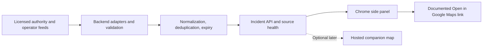

# Feasibility review

Reviewed: October 30, 2026. Status: research-backed proposal, **not a tested integration or legal clearance**. Recheck platform documentation and applicable terms before implementation and release.

## Conclusion

Proceed with a **desktop Chrome Manifest V3 side-panel prototype**, conditional on a usable, licensed local disruption feed. The side panel can provide useful incident information without drawing directly onto Google's map. Chrome documents both side panels and content scripts. [C1, C2]

The highest product risk is obtaining sufficiently fresh, trustworthy local data, not rendering incident cards. That is a planning judgment to validate during discovery.

## Integration options

| Approach | Assessment | Decision |
| --- | --- | --- |
| Chrome side panel next to Google Maps | Documented extension UI; can show our incident data without modifying map rendering. [C1] | Recommended MVP. |
| Toolbar popup | Simple entry point for a summary; less room for browsing and comparing incidents. | Optional launcher, not the primary interface. |
| Floating DOM panel on Google's page | Content scripts can insert DOM UI; host layout changes can break placement. This does not supply geographic map projection. [C2] | Defer until a demonstrated UX need. |
| Geographically anchored shapes on the consumer Google Maps map | No supported third-party overlay entry point was established in the reviewed docs. Do not confuse the consumer site with Maps JavaScript API. [G1] | Research spike only; not a launch dependency. |
| Hosted companion map using Maps JavaScript API | Documented custom overlays on a map we instantiate; billing, API credentials, attribution, and terms apply. [G1, G3, G4] | Supported spatial-view alternative, subject to budget and review. |

The direct-overlay assessment is an inference from the documented API boundary, not proof that no workaround exists. Do not promise private-API access, stable DOM selectors, store approval, or Google endorsement.

## What the extension can and cannot do

- Host an incident list and detail view in Chrome's side panel, using the documented permission and user-interaction requirements. [C1]
- Use content scripts when necessary; their isolated JavaScript environment does not automatically expose the host page's internal map object. [C2]
- Fetch our backend from an extension context with narrowly scoped host permissions. Content-script requests still have cross-origin constraints; do not assume permissions bypass those everywhere. [C3]
- Open a location using documented Maps URLs without a Google API key. This opens Maps; it does **not** inject an incident into Google's dataset or instruct routing to avoid it. [G2]
- Use custom geographic overlays on our own Maps JavaScript API map. It is not a drop-in API for the consumer website. [G1]

Start with manual pilot-city/area selection. Any later reading of the current Maps tab needs a separate permission/privacy decision and a tested adapter. A page URL is not a reliable contract for full viewport bounds, selected route geometry, or navigation state.

## Data feasibility

Google documents a traffic layer with region-dependent coverage and updates that are not instantaneous. This should be acknowledged as existing functionality, not treated as an unrestricted incident feed for our backend. [G5, G4]

| Candidate input | Potential contribution | Required pilot validation |
| --- | --- | --- |
| Transit agency GTFS Realtime alerts | Service disruptions affecting routes, trips, or stops. [D1] | Public access, license, identifiers, update cadence, coverage, and usable descriptions. |
| Municipal/road-authority feeds | Roadworks, closures, or traffic incidents, if published. | Availability is city-specific; confirm geometry, redistribution rights, and reliability. |
| Official operator or authority notices | Planned strikes or event-related service changes. | Prefer licensed structured feeds; confirm permission before any automated extraction. |
| Commercial incident provider | Potentially broader coverage. | Obtain coverage samples, pricing, redistribution/display rights, and credentials. |
| Community reports | Potentially fill coverage gaps. | Deferred: needs moderation, abuse prevention, privacy, and correction workflows. |

GTFS Realtime alerts include active periods and affected entities; do not assume they include a road blockage polygon. Resolve agency-scoped identifiers against the matching static GTFS dataset when available. Show an alert as a route/stop description if a reliable location cannot be derived. [D1]

For every proposed feed, record owner, URL, license/permission evidence, attribution, allowed retention, authentication, rate limits, time zone, sample payload, last successful fetch, and freshness expectations. Publicly reachable does not mean freely reusable. **The [Munich data audit](MUNICH_DATA_PLAN.md) now documents official source research and a successful bounded roadworks GeoJSON fetch. Production ingestion, sustained reliability, comprehensive coverage and authorized realtime transit-alert access remain unverified.**

## Proposed architecture

Proposed stack, not a committed dependency choice: TypeScript for shared contracts, React for side-panel UI, a small TypeScript backend, and PostgreSQL/PostGIS if spatial queries justify it. Use deterministic fixtures before adding infrastructure. Keep provider credentials server-side and keep source adapters separate from UI logic.

Suggested API: `GET /incidents?area_id=...&mode=...&type=...&status=...`, optionally bounded by `bbox` when supported, plus `GET /sources/health`. Specify pagination, maximum query area, caching, error responses, and freshness metadata before building clients. Return source coverage even when there are zero incidents.

### Minimum incident contract

| Field | Meaning |
| --- | --- |
| `id`, `source_id`, `source_incident_id` | Stable internal identity and source-scoped external identity. |
| `type` | Protest, strike, breakdown, closure, congestion, or other. |
| `impact`, `travel_modes` | Closure/delay/service interruption/unknown; affected modes. Keep cause separate from impact. |
| `title`, `description`, `area_label` | Neutral user-facing summary and affected location/service. |
| `geometry`, `geometry_precision` | Nullable GeoJSON in WGS84, longitude before latitude; exact, approximate, or unknown. |
| `affected_entities` | Agency-scoped route, stop, trip, or road references where available. |
| `starts_at`, `ends_at` | Nullable UTC validity bounds; unknown end must remain unknown. |
| `source_updated_at`, `fetched_at`, `expires_at` | Distinguish source publication, successful retrieval, and display expiry. |
| `verification_status`, `status` | Separate provenance verification from scheduled/active/resolved lifecycle. |
| `source_url`, `attribution` | Evidence link and required credit. |

Use per-source freshness rules. A fresh fetch must not make an unchanged, old notice appear newly confirmed. Preserve underlying source identities when deduplicating, accept corrections, and distinguish resolved incidents from those hidden because evidence became stale. Never infer a precise blocked road from an approximate event location.

## Permissions, policy, and privacy gates

- Request only permissions justified by implemented features: side panel, local preferences if needed, and the exact backend host. Avoid broad browsing access; evaluate optional site permission or user-triggered access only if a content script is required. [C1, C2, C3, C5]
- Bundle executable extension code. Manifest V3 restricts remotely hosted code; do not assume a CDN-hosted map SDK can run directly inside the privileged extension panel. Prefer a separately hosted map page and review its integration boundary. [C4]
- Do not scrape Google Maps traffic, tiles, reviews, or route content into a disruption database. Review consumer Maps terms separately from Maps Platform terms; which obligations apply depends on the chosen integration and account/region. Get qualified review where needed. [G4, G6]
- Google map use in a hosted application requires billing/authentication setup and budget controls; do not assume it is free or that budget alerts cap spending. No price estimate is committed until usage and providers are selected. [G3]
- Disclose handling of browsing or location-related data, including local-only handling, and prepare a privacy policy before publication. Prefer manual area selection, no journey-history storage, no background geolocation, and no analytics in the pilot. [C5]
- Treat feed descriptions as untrusted text, allowlist outbound URL schemes, validate backend responses and extension messages, and prevent arbitrary URL fetching through privileged extension handlers. [C3]

These are implementation/review requirements, not a legal opinion or a prediction of Chrome Web Store approval.

## Go / no-go evidence

Proceed to an MVP only after the team demonstrates:

1. A named pilot area and at least one source with documented display/redistribution permission and useful samples.
2. A loadable Manifest V3 side panel showing clearly labeled fixtures without requiring private Google Maps internals.
3. A trustworthy location/service description, source freshness, and failure/empty-state behavior.
4. A privacy/permissions proposal, any map-provider costs, and feed maintenance ownership.

If the data gate fails, continue only as a clearly labeled mock-data UX prototype. If direct map anchoring fails, retain the side-panel product rather than attempting increasingly brittle private-map hooks.

## Official sources

Checked October 30, 2026. References support platform capabilities and constraints, not our untested product assumptions.

- C1: [Chrome Side Panel API](https://developer.chrome.com/docs/extensions/reference/api/sidePanel)
- C2: [Chrome content scripts and isolated worlds](https://developer.chrome.com/docs/extensions/develop/concepts/content-scripts)
- C3: [Extension cross-origin requests and security](https://developer.chrome.com/docs/extensions/develop/concepts/network-requests)
- C4: [Chrome Web Store Manifest V3 requirements](https://developer.chrome.com/docs/webstore/program-policies/mv3-requirements)
- C5: [Chrome Web Store user-data and privacy requirements](https://developer.chrome.com/docs/webstore/program-policies/user-data-faq)
- G1: [Maps JavaScript API custom overlays](https://developers.google.com/maps/documentation/javascript/customoverlays)
- G2: [Maps URLs](https://developers.google.com/maps/documentation/urls/get-started)
- G3: [Maps JavaScript API usage and billing](https://developers.google.com/maps/documentation/javascript/usage-and-billing)
- G4: [Google Maps Platform terms](https://cloud.google.com/maps-platform/terms)
- G5: [Traffic, transit, and bicycling layers](https://developers.google.com/maps/documentation/javascript/trafficlayer)
- G6: [Google Maps end-user additional terms](https://www.google.com/help/terms_maps/)
- D1: [GTFS Realtime reference](https://gtfs.org/documentation/realtime/reference/)
